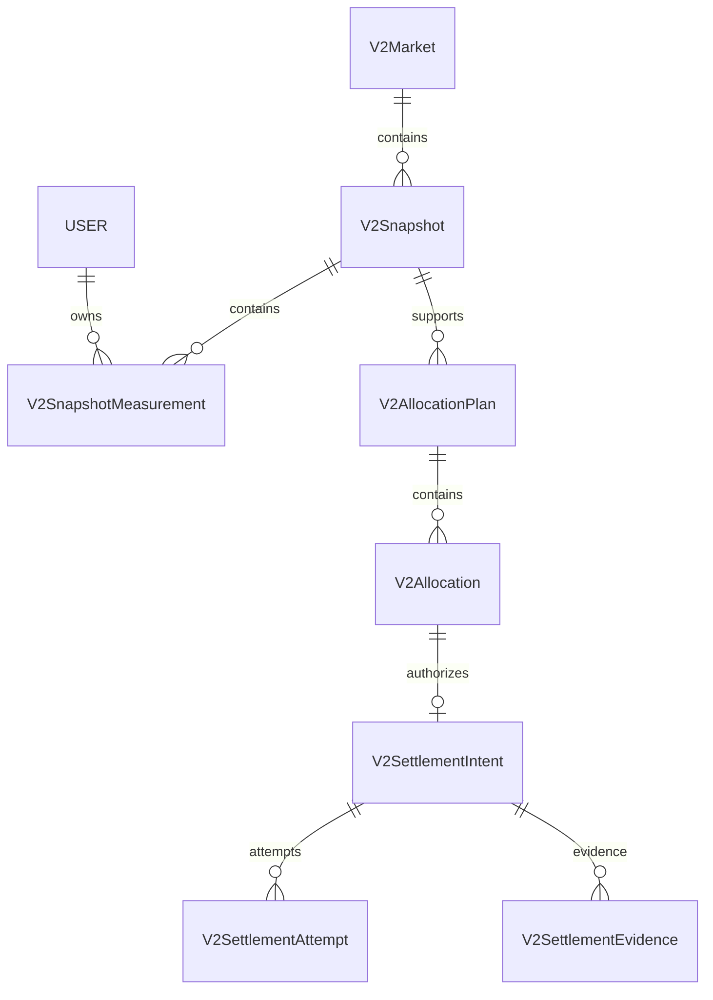

# B21 shared contracts and database

B21 extends the accepted B20 baseline `f605e66dfb0d745d1fcf174004ddb594f9fa196a` with versioned V2 data contracts, deterministic identities and additive PostgreSQL models. It does not implement matching, scheduling, wallet authorization or blockchain settlement. Matching is a financial allocation of measurements, not proof of the physical electricity path.

The original staged B21 migration remains unchanged. `database/migrations/20261119010000_b21_snapshot_plan_integrity/migration.sql` is a separate additive correction. It fails closed before changing anything if it finds existing V2 allocations or finalized snapshots; those require an explicitly reviewed migration rather than fabricated backfill. Session evidence covers only our disposable databases, not every possible external environment. No migration was applied to a project database.

`V2SnapshotMeasurement` holds source readings per snapshot and user. A snapshot starts pending, accumulates readings, and can finalize only when its counts and SHA-256 payload hash match those readings. Triggers serialize finalization and measurement writes and reject later insert/update/delete. A correction is a new snapshot with its own records and `supersedesId`; old readings and allocations remain. `V2Position` is a market accounting projection, not the authoritative source of historical measurements.

`V2AllocationPlan` holds an immutable versioned matching-input manifest and hash. Draft plans permit alternatives, including plans based on a corrected finalized snapshot. Exactly one plan per market can become authoritative; it cannot be replaced or deleted, and its allocations are sealed at activation. The additive payment-readiness migration requires allocations to start planned, validates their individual manifest terms, prevents activation while planned allocations remain, and permits intents only for validated allocations in the authoritative plan. Cancelled allocations cannot become payable. This prevents competing plan versions authorizing payment, but does not establish exactly-once chain execution. Compensation or reversal is deliberately not implemented.

The manifest commits snapshot/market/interval, per-user quantities, roles, prices, energy type and preference, reputation, coordinates and wallet, and algorithm, pricing, distance and scoring settings. Node, Python and PostgreSQL use versioned SHA-256 over ordered compact JSON arrays; participant records sort by lowercase UUID. Canonical decimal strings are used, with no floating-point financial arithmetic. PostgreSQL checks the manifest hash, snapshot hash and measurement agreement before accepting a plan. See [design and evidence](docs/B21-DESIGN.md) and `packages/shared/fixtures/v2-matching-manifest-vectors.json`.

Payment arithmetic preserves quotient and remainder of `quantityWh * priceMicrousdPerKwh / 1000`; no dust, rounding, fee or aggregation policy is selected. A verified database flag is not independent proof of Hedera finality. B22 must approve pricing/finality policy and aggregate quantity handling; B23 must define the deployed settlement domain; B24 must address buyer authority and prefunding; B25 must authenticate receipt/event evidence and safely reconcile uncertain outcomes.

Run `powershell -NoProfile -ExecutionPolicy Bypass -File tools/b21-run-postgres-tests.ps1` from the repository root with Docker Desktop running and a locally available `postgres:17` image. The harness creates a unique labeled container with generated temporary credentials and a loopback-only dynamic port, checks target/ownership markers, and cleans up only its own container and anonymous volume. It tests fresh Prisma migration deployment, an isolated original-B21 regression schema, a synthetic populated legacy database with a Prisma migration ledger, rejection and concurrency scenarios, and SQL/Node/Python hash vectors. It never uses the project `DATABASE_URL` as a test target or edits `.env`.
