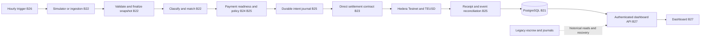

# V2 target: automated hourly market

This is a proposed architecture, not current implementation. Existing generator, schemas, matcher, custodial backend and legacy escrow exist; finalized provenance, scheduler, direct settlement, worker and dashboard are future work. Testnet only. No guarantee of physical delivery or energy routing follows from financial allocation.



```mermaid
sequenceDiagram
 participant T as Trigger
 participant V as Snapshot finalizer
 participant M as Matcher
 participant W as Settlement worker
 participant DB as PostgreSQL
 participant H as Hedera Testnet
 T->>DB: Acquire interval lease and unique market run
 T->>V: Request completed UTC interval
 V->>DB: Persist validated snapshot provenance and hash
 V->>M: Finalized snapshot and policy version
 M->>DB: Persist deterministic allocation plan or empty result
 W->>DB: Persist immutable intent and signing reference
 W->>H: Authorized direct transfer through settlement contract
 H-->>W: Receipt or uncertain response
 W->>H: Reconcile original identity and verify events
 W->>DB: Project confirmed evidence atomically
 Note over W,DB: Timeout or DB failure remains recoverable; never blindly rebroadcast
```

## Boundaries and contracts

1. B26 trigger uses UTC hourly half-open boundaries and processes only completed intervals; a lease plus unique market/interval prevents concurrent runs. An accelerated demonstration advances distinct simulated intervals, never charges an identical historical interval twice. Persist clock/source mode and ensure no mixing with real intervals.
2. B22 ingests the generator's records, records source/config/version, expected participant set, timestamps and completeness. Reject duplicates, missing users, malformed units, out-of-window, impossible, negative or inconsistent measurements and unauthorized or changed sources. Quarantine until an authorized finalizer approves under a versioned policy; a content hash proves integrity, not truth.
3. For each user calculate integer `netEnergyWh = productionWh - consumptionWh`; positive SELLER, negative BUYER, zero NEUTRAL. Generate or retain configured terms under a versioned B22 pricing policy. Matcher accepts final snapshot identity/hash, policy/config versions, users with UUIDs, wallets, Wh, prices, types, coordinates, reputation and UTC slot; output includes deterministic allocation IDs, buyer/seller, quantity, price and unmatched quantities. Validate per-buyer and per-seller sums independently of Python. Existing greedy matcher requires a single seller to fill a buyer; partial allocation is a B22 choice. Empty matches complete normally.
4. B24/B25 check participant identity, buyer authorization and revocation, token balance and allowance, network, contract, fees and operator scope. Checks can become stale: the contract must enforce its own transfer and replay invariants atomically. Amount is `quantityWh * priceMicrousdPerKwh / 1000` token base units, using bounded integer arithmetic; remainder, zero amount, aggregation and dust require explicit versioned B22 policy before settlement. Never silently discard value.
5. B23 contract accepts an immutable, domain-separated settlement identity and terms, restricts caller and buyer authorization, prevents reuse, safely transfers TEUSD from buyer to seller atomically, emits verifiable terms and supports emergency controls. B25 verifies successful receipt, chain/contract/token identity, settlement ID, buyer, seller, amount, and matching token Transfer event; only then mark confirmed. Preflight is not confirmation.
6. B21 adds durable snapshots, runs, allocations, attempts, evidence and projection records without altering historical meaning. Persist canonical unsigned integers safely (avoid JS precision loss), ISO 8601 UTC, UUID user/match identifiers, existing Hedera account and EVM address conventions. B27 exposes authenticated, ownership-filtered production, consumption, net, bought/sold, confirmed paid/earned, wallet balance and history, plus controlled top-up request. Keys and signing data never reach frontend. Distinguish pending from confirmed and wallet balance from settlement totals.

## Energy and payment accounting

For each participant and interval, retain measured total production and consumption separately in Wh. Net position is production minus consumption; it is not the P2P traded quantity. The P2P matched quantity is the sum of validated allocations, bounded by the relevant net surplus or deficit. P2P bought is the buyer's matched quantity; P2P sold is the seller's matched quantity. Unmatched energy is the remaining deficit for a buyer or surplus for a seller after matching; a neutral position has neither. Matching is a financial allocation, not proof of physical delivery, and a matched quantity is not proof of payment.

Track confirmed TEUSD paid by buyers and earned by sellers only from verified successful settlement evidence. Show pending, unknown, blocked and failed payments separately, without including them in confirmed totals. Wallet balance is a separate chain-derived balance: controlled test-token top-ups are funding, not earnings, and must not increase confirmed P2P earnings.

Because energy has already been consumed by the time matching runs, insufficient buyer funds or authorization can leave an allocation unpaid and a seller exposed to nonpayment. Before unattended settlement, B22 must decide versioned price policies and their interaction with payment eligibility; B23 must decide the settlement contract's enforceable authorization and payment constraints; B24 must decide prefunding, payment eligibility, standing authorization, spending caps, revocation and their enforcement across custody and the contract. These are mandatory decisions and tests, not approved implementations. No policy may treat a readiness check as a guarantee of later payment.

## Proposed states and recovery

Market run: `DISCOVERED -> WAITING_DATA -> FINALIZED -> MATCHED -> SETTLING -> COMPLETE` (including empty outcome), with `INVALID/QUARANTINED`, `PARTIAL` and `RECONCILIATION_REQUIRED` branches. Settlements: `PLANNED -> READY -> SIGNED -> SUBMITTED -> CONFIRMED -> PROJECTED`; `BLOCKED`, `REVERTED` and `UNKNOWN` are explicit. Only confirmed evidence yields payment totals; signed/submitted/unknown require transaction-identity reconciliation before any retry. Reverted retries require proven final failure, unchanged immutable ID and on-chain replay protection. Define exact transitions and finality in B25.

| Situation | Required handling |
| --- | --- |
| No buyers, sellers, or compatible matches | Record completed empty run and unmatched quantities; no payment. |
| Incomplete or invalid readings | Quarantine; no matching or settlement until finalization. |
| Insufficient balance or allowance | Block allocation, record reason; do not credit seller. Later handling is policy-gated. |
| Timeout or unknown submission | Preserve signed transaction identity and intent; reconcile same identity; never blind rebroadcast. |
| Failed receipt | Record failure, no credit; retry only after conclusive failure and controlled policy. |
| DB sync failure | Preserve chain evidence, retry idempotent projection; do not pay again. |
| Duplicate hourly execution | Resume existing unique run and immutable plan; never duplicate settlement. |
| Partial settlement | Record each allocation separately; confirmed payments remain final, blocked or unknown ones reconcile independently; run reports partial. |
| Correction after settlement | Preserve original data, hash, allocations and evidence. Quarantine correction; reviewed, separately identified compensating adjustment only after B22/B25 policy; never overwrite or automatically repay. |

Trust boundaries: simulator/ingestion is untrusted input; finalizer is accountable but can be wrong; matcher output is validated; backend custody and operator are privileged; chain receipts/events and configured deployment identity must be verified; database and dashboard are projections. Logs must exclude keys and signed payloads. Threats include manipulated readings, compromised signing keys, duplicate jobs and ambiguous network outcomes. Operational review, access controls, rate limits and audit logs are required.
